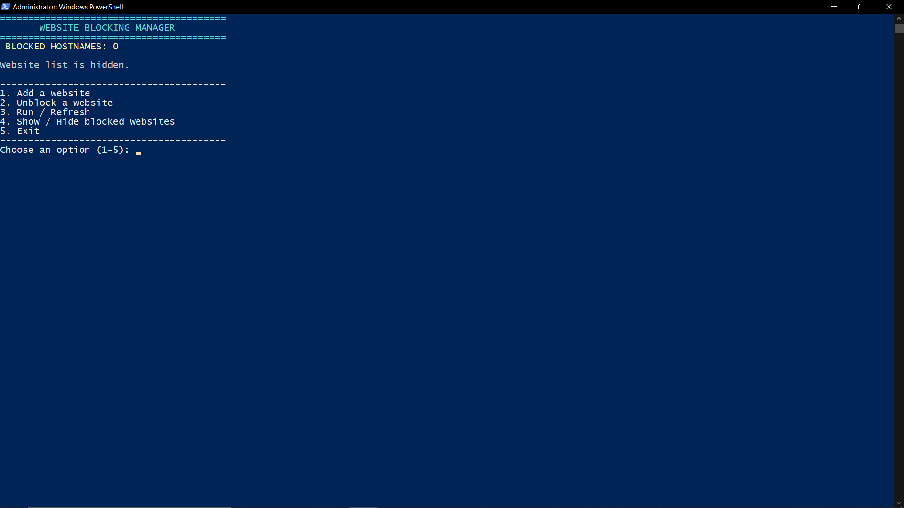

# 🛡️ Windows Hosts File Blocking Manager

> A lightweight, interactive PowerShell utility designed to simplify and automate website blocking and `hosts` file management on Windows systems.

---

## 📌 About the Project

Managing website blocks manually through the Windows `hosts` file (`C:\Windows\System32\drivers\etc\hosts`) can be tedious, error-prone, and time-consuming for IT support staff. 

**Website Blocking Manager** was built during an IT Support internship to streamline this workflow. It provides a safe, menu-driven interface to add, remove, and manage blocked domains while automatically handling administrative permissions, file backups, and DNS cache flushing.

## 📸 Preview

Here is what the interactive CLI menu looks like in action:

---

## ✨ Key Features

- **🔐 Automatic Administrator Check:** Verifies elevated privileges on startup and prompts if the script needs to be run as Administrator.
- **💾 Automated Backups:** Automatically creates a timestamped backup (`.bak`) of your hosts file before any modifications are made, ensuring you can always roll back safely.
- **🔍 Smart Domain Parsing:** Uses regular expressions to safely read, parse, and validate domain entries mapped to loopback addresses (`127.0.0.1` or `0.0.0.0`).
- **⚡ Instant DNS Refresh:** Automatically flushes the local DNS cache (`ipconfig /flushdns`) immediately after changes are applied so blocks take effect instantly.
- **🖥️ Interactive CLI Menu:** Clean, user-friendly command-line interface to add websites, unblock domains, view current blocklists, and refresh settings.

---

## 🚀 How to Use

1. **Clone or download the repository** into a local folder.
2. Ensure both `WebsiteBlockingManager.ps1` and your batch launcher (`.bat`) are in the same directory.
3. **Double-click the batch file** (`.bat`), and click **Yes** on the UAC administrator prompt. The script will automatically launch with the correct execution policies and elevated privileges!
